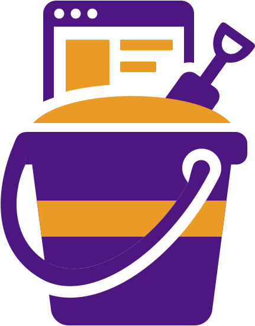

# Sandbin

[](https://github.com/yookoala/sandbin/actions/workflows/ci.yml?query=branch%3Amain)

A simple PUT/GET server for CLI agents in sandbox to submit HTML / ANSI mock up previews
or simple prototyping.

With a fixed pre-shared API key, a client may use POST to create a bin (for a collection
of preview pages) with a randomly assigned hash path. Then a client may PUT markdown /
HTML / ANSI text to subpaths of the bin.

Client may specify additional password protections (Basic Auth) to the bin it created.

The base path of the bin, if not specified with an index.html, will automatically has
directory listing for the items in it.

A bin can also say what it holds: a one-line title and description, set when it is created,
edited afterwards with PATCH, and read back at the bin base.

All contents are stored in a single sqlite file. A db written before metadata existed gains the
columns for it the next time a `serve` opens it, so upgrading needs no manual step.

## Quick start

**1. Run the server** (needs Go on the server machine):

```sh
make                                           # -> dist/sandbin and dist/sandbin-client
SANDBIN_API_KEY=your-key ./dist/sandbin serve    # listens on :8080
```

`make` stamps the build from git, so `./dist/sandbin --version` answers `v0.3.0 (1abcdef)` on a
tagged commit, `v0.3.0+ (2abcdef)` a few commits past a tag, or `dev (3abcdef+)` with
uncommitted tracked work. A binary installed with `go install
github.com/yookoala/sandbin/cmd/sandbin@v0.3.0` instead names the tag alone (`v0.3.0`), because
a downloaded module copy has no git to ask; see [Running the server](docs/usages/sandbin-serve.md).

Sanity-check it with curl, on that machine:

```sh
BIN=$(curl -s -X POST -H "X-API-Key: your-key" http://localhost:8080/)   # -> /abc1234/
curl -X PUT -H "X-API-Key: your-key" -d '<h1>Hello</h1>' "http://localhost:8080${BIN}index.html"
curl http://localhost:8080${BIN}                                         # -> the page
```

**2. Set up the client** on the machine your agent works on — Go is needed there too,
because the installer builds the client binary. Run the one-liner once in each project
directory you want to upload from, naming your server's address:

```sh
cd ~/work/my-project
curl -fsSL http://your-server:8080/skills/sandbin-preview/install.sh | bash
```

It installs the agent skill into `$HOME/.agents/skills/sandbin-preview`, builds
`sandbin-client` next to it, and at a terminal asks for the API key once, saving it and
the server address into that directory's `.sandbin.yaml`. (Piped without a terminal it
prints the `init` command to finish instead.)

**3. Upload a preview** from that project directory:

```sh
"$HOME/.agents/skills/sandbin-preview/sandbin-client" upload prototype/index.html
# created http://your-server:8080/abc1234/prototype/index.html
# http://your-server:8080/abc1234/          <- hand this URL to a human
```

## Documentation

Usage docs come in two sets, each with its own summary and content table:

- **[docs/usages/sandbin.md](docs/usages/sandbin.md)** — the server: running it, the HTTP API,
  the API key lockout, running it with podman, managing blocked addresses.
- **[docs/usages/sandbin-client.md](docs/usages/sandbin-client.md)** — the client: uploading and
  deleting previews, pointing it at a server, and the agent skill + one-line installer.

A running server hosts these same pages under `/docs`: the hub at `/docs/`, the two summaries at
`/docs/sandbin.html` and `/docs/sandbin-client.html`, and every page each set covers at its own
`/docs/<name>.html`.

An agent learns the client from the skill the Quick start installed; it can also be fetched
from any running server at `GET /skills/sandbin-preview/SKILL.md`.

# License

This software is licensed under the MIT License. You can find a copy of the license [here](LICENSE.md).
